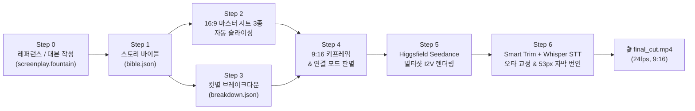

# 🎬 Short Drama Studio — AI 숏폼 드라마 자동 제작 파이프라인

**유튜브 쇼츠 / 릴스 / 틱톡용 9:16 세로형 K-드라마**를 대본 기획부터 캐릭터·배경·소품 마스터 시트, 컷별 키프레임, 멀티샷 I2V 비디오 렌더링, Whisper STT 정밀 자막 번인 및 자동 무음 트리밍까지 **원스톱으로 제작하는 프로덕션 파이프라인 & 웹 스튜디오**입니다.

---

## ✨ 핵심 특징

- **원클릭 웹 대시보드 (`http://localhost:8899`)**: 1~5단계 탭 UI에서 대본 작성 → 에셋 검수/교체 → 키프레임 단독 리롤 → 비디오 이어하기 렌더링 → 최종 컷 합본까지 직관적으로 제어
- **강력한 인물·공간 일관성**: 16:9 마스터 시트 3종(캐릭터/장소/소품) 자동 슬라이싱 + `face.png`/`sheet.png` 분리 + 이전 씬 무음 영상(`_muted.mp4`) 연속 참조
- **시네마틱 연출 엔진**: 6대 공간 카메라 앵커, 16종 카메라 무브먼트, 25종 해부학적 미세 표정 연기, 180도 가상선 & 3차원(Z축) 공간 깊이 지시, 정지 사진(`tableau`) 금지 규칙
- **쇼츠 최적화 자막 & 편집 엔진**: OpenAI Whisper 단어별 실제 타임스탬프 1:1 싱크 + 대본 참조 범용 Bigram 오타 교정 + 한국어 의미 단위(조사/연결어미/의존명사 보호) 분할 + 1.3배 확대(`53px`) 1줄 하드섭 + 자동 무음 여백 트리밍(`Smart Silence Trim`)

---

## 🗺️ 전체 파이프라인 아키텍처



---

## 🛠️ 사전 준비물 (Prerequisites)

macOS (Apple Silicon 기준) 환경에서 아래 도구들이 설치되어 있어야 합니다.

| 도구 | 용도 | 설치 / 확인 |
| :--- | :--- | :--- |
| **Python 3.9+** | 파이프라인 및 대시보드 서버 | `python3 --version` (`pillow`, `numpy`, `pyyaml`, `jsonschema`) |
| **FFmpeg / FFprobe** | 24fps 영상 결합, 무음 트리밍, 자막 오버레이 | `brew install ffmpeg` (`/opt/homebrew/bin/ffmpeg`) |
| **OpenAI Whisper CLI** | 단어 단위 한국어 STT 타임스탬프 추출 | `brew install openai-whisper` (`/opt/homebrew/bin/whisper`) |
| **Higgsfield CLI (`hf`)** | 이미지(`nano_banana_2_1`) 및 비디오(`seedance_2_0_mini`) 생성 | `higgsfield` CLI 로그인 완료 상태 |
| **Antigravity CLI (`agy`)** | 시놉시스/대본/바이블/브레이크다운 생성 브릿지 | `~/.gemini/bin/agy` 로그인 완료 상태 |
| **yt-dlp** *(선택)* | 레퍼런스 쇼츠 URL 제목·자막 자동 수집 | `brew install yt-dlp` |

---

## 🚀 처음부터 설치 & 빠른 시작 (Quick Start)

### 1. 저장소 클론 및 Python 패키지 설치
```bash
git clone <YOUR_REPO_URL>
cd short_drama_test

# 가상환경 권장 (선택)
python3 -m venv .venv && source .venv/bin/activate

# 필수 파이썬 패키지 설치 (Pillow, numpy, PyYAML, jsonschema)
pip install -r requirements.txt
```

### 2. 외부 CLI 도구 설치 (macOS Homebrew 기준)
```bash
# 1) FFmpeg (영상 결합/트리밍/자막 번인), Whisper (단어 타임스탬프 STT), yt-dlp (레퍼런스 수집)
brew install ffmpeg openai-whisper yt-dlp

# 2) Higgsfield CLI 설치 및 로그인 (이미지/비디오 생성)
npm install -g @higgsfield/cli
higgsfield auth login

# 3) Antigravity CLI (agy) 로그인 상태 확인 (대본/바이블/브레이크다운 생성)
agy --version
```

### 3. 환경 변수 & 설정 파일 확인
```bash
# 선택: OpenAI 폴백을 사용할 경우에만 .env 생성 후 키 입력
cp .env.example .env
```
- `config.yaml`의 `paths.ffmpeg_bin`이 본인 PC의 `which ffmpeg` 경로(`/opt/homebrew/bin/ffmpeg` 등)와 맞는지 확인하세요.

### 4. 로컬호스트(웹 대시보드) 실행 · 종료 · 재시작
프로젝트 폴더에서 아래 명령어를 실행하면 로컬 웹 서버(`8899` 포트)가 켜집니다:

```bash
# 1) 가장 간단한 실행 (pnpm / npm)
pnpm dev

# 또는 Python 직접 실행 (종료 시 Ctrl + C)
python3 dashboard_server.py

# 2) 백그라운드 실행 (터미널을 닫아도 계속 켜두기)
nohup python3 dashboard_server.py > dashboard_server.log 2>&1 &

# 3) 실행 중인 로컬호스트 종료 / 재시작
pnpm stop
pnpm restart
```
서버가 켜지면 브라우저에서 **[http://localhost:8899](http://localhost:8899)** 로 접속합니다.
*(가상환경을 만들었다면 실행 전에 `source .venv/bin/activate`를 먼저 입력해 주세요.)*

### 5. 대시보드 단계별 제작 워크플로우

| 탭 | 작업 내용 | 실전 팁 |
| :--- | :--- | :--- |
| **1. 대본 (Script)** | 새 프로젝트 생성 후 레퍼런스 URL/메모로 시놉시스 3안 → 대본 자동 생성 또는 직접 입력 후 저장 | 대본 수정 후 반드시 **저장**을 누른 뒤 바이블 생성 |
| **2. 바이블 & 샷 (Step 2)** | **바이블·브레이크다운 생성** 클릭 (`bible.json` + `breakdown.json` 자동 생성, 약 2~4분 소요) | Step 2-2 샷 리스트에서 카메라 구도와 대사 분량을 미리 검수 |
| **3. 에셋 (Assets)** | 16:9 마스터 시트 3종(캐릭터 / 장소 / 소품) 생성 및 개별 이미지 자동 슬라이싱 | 마음에 안 드는 캐릭터·배경은 개별 수동 업로드로 즉시 교체 가능 |
| **4. 키프레임 (Keyframes)** | 첫 씬(`seg01`) 및 독립 씬(`keyframe`)의 9:16 시작 이미지 생성 & 씬 연결 방식 확인 | `state_reference` / `previous_frame` 씬은 키프레임 비용 절약 |
| **5. 테이크 & 최종 컷** | **영상 생성** 실행 (`seedance_2_0_mini` 기본) → 완료 후 **최종 컷 합치기** 클릭 | 중단 시 **미생성 항목만 이어하기**로 크레딧 절약, 개별 컷은 **단독 렌더링** |

### 6. CLI 단독 실행 (선택)
```bash
# 특정 프로젝트 최종 컷 + 자막만 빠르게 재합성
python3 -c "
from pipeline.stage6_cut import build_final_cut
print(build_final_cut('outputs/프로젝트명', 'EP001', burn_subtitles=True, trim_silence=True))
"
```

---

## 🧠 핵심 제작 규칙 & 고도화 기능 가이드

### 1. 캐릭터·배경 에셋 품질 규칙 (`templates/bible.md`, `pipeline/stage2_assets.py`)
- **역할별 안면 아키타입 (`Anti-Homogenization`)**: 모든 캐릭터가 획일적인 V라인 아이돌 얼굴로 나오지 않도록 악역(날카로운 눈매·각진 턱), 주인공(단단하고 자연스러운 눈빛), 원로/회장(연륜 주름·중후한 골격), 추종자 등 배역별 안면 골격을 극명하게 대비시킵니다.
- **배경 100% 무인화 (`ABSOLUTE ZERO PEOPLE`)**: 장소 마스터 시트 및 개별 배경에 행인·직원·실루엣이 1명도 들어가지 않도록 강력한 무인 배경 규칙과 네거티브 프롬프트를 적용합니다.

### 2. 카메라 무빙 & 3차원 공간 연출 (`templates/breakdown.md`, `templates/video-prompts.md`, `pipeline/stage5_higgsfield.py`)
- **6대 공간 카메라 앵커 & 연속 복붙 금지**: `Master Staging(와이드)`, `3-tier OTS(어깨 너머 3단 깊이)`, `Side Profile(90도 옆모습)`, `Reverse Reaction`, `Macro Insert`, `Low/High Angle`을 대본 상황에 맞게 교차합니다.
- **3차원(Z축) 지목 & 전경 유지 규칙**: OTS 구도에서 카메라 바로 앞(전경) 인물을 손가락질할 때는 평면 `screen-left/right`가 아닌 **`diagonally FORWARD toward the immediate foreground`**로 지정하고, 전경 대상을 프레임 밖으로 잘라내는 전진 `push-in`을 금지해 제3자 오지목 착시를 방지합니다.
- **정지 사진(`tableau`) 금지 (`Living Motion Rule`)**: 엔딩이나 침묵 샷에서 배우가 마네킹처럼 멈춰 서는 현상을 막기 위해 `tableau`/`motionless` 표현을 금지하고 살아있는 연속 동작을 강제합니다.
- **정규식 단어 경계(`\b`) 카메라 매칭**: `"executive"` 안의 `"ecu"`가 `macro_insert`로 오탐되는 등의 부분 문자열 버그를 차단했습니다.

### 3. 레퍼런스 이미지 스마트 관리 (`pipeline/stage5_higgsfield.py`)
- **Seedance 9장 총합 한도 엄수**: `start_image`까지 합산해 최대 9장을 초과하지 않도록 `start_image`가 있으면 `image_references`를 최대 8장, 없으면 9장으로 자동 제한합니다.
- **미등장 인물 최우선 + 전신 시트(`sheet.png`) 자동 전환**: 시작 화면에 없다가 컷 전환으로 새로 등장하는 인물을 1순위로 배치하며, 4명 이상+오브제 등으로 슬롯 한도를 넘으면 자동으로 캐릭터당 `sheet.png`(얼굴+전신 통합 시트) 1장 모드로 전환해 누락 0건을 보장합니다.
- **소품 피켓 누수 차단 & 시선 오리엔테이션**: 일반 인물 대화 샷에서는 서류 앞면 시트(`props/*/sheet.png`) 레퍼런스를 제외해 0.0초에 서류를 카메라 정면 피켓처럼 들이미는 슬롭을 차단하고, 금액·글자를 강조하는 **단독 매크로/인서트 샷**에만 소품 시트를 주입합니다.
- **이전 영상 무음화(`_muted.mp4`) & 자동 재시도**: 이전 씬 영상을 참조할 때 오디오 트랙을 제거해 대사 반복/환각을 차단하며, Higgsfield 일시적 5xx 업로드 오류 시 최대 3회 자동 재시도합니다.

### 4. Whisper STT 정밀 자막 & 자동 무음 트리밍 (`pipeline/stage6_cut.py`)
- **단어별 실제 타임스탬프 1:1 보존**: Whisper의 단어별 `[start, end]` 객체를 끝까지 유지한 채 오타 텍스트만 교정하고 토큰 단위로 분할하므로 입 모양과 자막 타이밍이 칼같이 일치합니다.
- **대본 참조 범용 Bigram 오타 교정 (`refine_stt_tokens_with_script`)**: 하드코딩 없이 대본의 1어절·2어절 합침(Bigram) 후보 + 앞뒤 단어 문맥 샌드위치 보너스 + 숫자 발음 정규화(`10비가` → `식비가`)로 STT 발화 뼈대는 유지하면서 오타만 자동 교정합니다.
- **의미 단위 분할 & 단위/의존명사 보호**: 연결어미(+10점)·격조사(+5점)에서 끊고, `15만 / 원씩`, `키운 / 줄` 같은 숫자+단위 및 의존명사 경계에는 `-15점` 페널티를 주어 자연스러운 1줄(16자 내외)로 분할합니다.
- **1.3배 확대(`53px`) 하드섭 번인**: 720p 기준 `w * 0.073` (약 `53px`) 볼드 한글 폰트 + 5px 검정 외곽선 + 반투명 라운드 박스, 화면 하단 82% 골든존 1줄 고정.
- **자동 무음 여백 트리밍 (`Smart Silence Trim`)**: 각 세그먼트 앞뒤의 불필요한 침묵을 `lead_pad=0.30s`, `tail_pad=0.40s` (마지막 씬 엔딩 여운 `0.80s`)만 남기고 정밀 트리밍한 뒤, 실제 잘린 길이 기준으로 자막 타임코드를 재정렬합니다.

---

## ⚙️ 주요 설정 (`config.yaml`)

```yaml
video:
  model: "seedance_2_0_mini"   # 기본 비디오 모델 (4~15초, 5 credits 가성비)
  aspect_ratio: "9:16"         # 세로형 쇼츠 표준
  resolution: "720p"           # 720p 또는 1080p
  fps: 24                      # 시네마틱 24fps 전역 고정

image:
  model: "nano_banana_2_1"     # 마스터 시트 & 키프레임 생성 모델
```
- 고화질 플래그십이 필요할 때는 대시보드 드롭다운에서 **`Seedance 2.0`**으로 즉시 전환할 수 있습니다.

---

## 📁 프로젝트 폴더 구조

```text
short_drama_test/
├── README.md                    # 설치 및 사용 가이드
├── requirements.txt             # 필수 Python 패키지 목록
├── .env.example                 # 환경 변수 예시 (.env 복사 후 사용)
├── config.yaml                  # 전역 모델·해상도·24fps·경로 설정
├── dashboard_server.py          # 로컬 웹 대시보드 백엔드 서버 (포트 8899)
├── dashboard/index.html         # 5단계 제작 스튜디오 프론트엔드 UI
├── run_pipeline.py              # CLI 파이프라인 진입점
├── pipeline/
│   ├── antigravity_bridge.py    # 시놉시스·대본·바이블·브레이크다운 생성 브릿지
│   ├── stage1_bible.py          # 스토리 바이블 스키마 검증 & 프롬프트 생성
│   ├── stage2_assets.py         # 16:9 마스터 시트 생성 & 자동 슬라이싱/얼굴 추출
│   ├── stage3_breakdown.py      # 에피소드 컷 분할 & 검증
│   ├── stage4_keyframes.py      # 9:16 키프레임 계획 & 멀티 레퍼런스 조합
│   ├── stage5_higgsfield.py     # Seedance I2V 프롬프트 조립, 연속성, 레퍼런스 관리
│   ├── stage6_cut.py            # Smart Silence Trim, Whisper STT 오타 교정, 53px 자막 번인
│   └── continuity.py            # 인접 씬 연결 모드(previous_frame / state_reference / keyframe) 판별
├── templates/                   # 바이블·브레이크다운·비디오·씬 프롬프트 템플릿
├── schemas/                     # JSON 스키마 정의 (bible, breakdown)
└── outputs/                     # 실행 시 자동 생성되는 프로젝트 산출물 (.gitignore 제외)
```

---

## 🔧 트러블슈팅 FAQ

- **코드 수정 후 대시보드에 반영이 안 돼요**
  - Python 모듈은 서버 시작 시 메모리에 로드되므로, 코드 수정 후 반드시 대시보드 서버를 재시작해야 합니다:
    ```bash
    kill $(lsof -t -i :8899) 2>/dev/null; python3 dashboard_server.py
    ```
- **영상 생성 중간에 끊겼어요 (크레딧 아끼고 싶어요)**
  - 대시보드 5번 탭에서 **미생성 항목만 이어하기 (`skip_existing`)**를 선택하면 이미 완성된 `segXX_take01.mp4`는 건너뛰고 남은 씬부터 이어서 렌더링합니다.
- **특정 1개 씬만 마음에 안 들어요**
  - 해당 씬 카드의 **단독 렌더링** 버튼으로 그 씬만 다시 뽑은 뒤, **최종 컷 합치기**를 다시 누르면 전체 영상이 새 테이크로 즉시 갱신됩니다.
- **자막만 다시 뽑고 싶어요 (영상 재렌더링 없이)**
  - 대시보드 5번 탭의 **최종 컷 합치기** 버튼은 기존 테이크를 재사용하므로 추가 크레딧 소모 없이 Whisper STT + 오타 교정 + 무음 트리밍 + 자막 번인만 다시 수행합니다.

